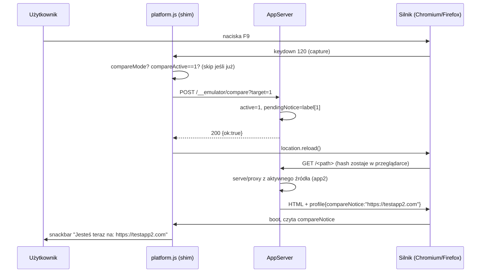

# Design Document: Tryb porównywania (Compare Mode)

## Overview

Tryb porównywania pozwala otworzyć dwie wersje tej samej aplikacji telewizyjnej obok siebie w jednej sesji silnika i przełączać się między nimi klawiszami F8 (aplikacja 1) i F9 (aplikacja 2). Przełączenie zachowuje bieżącą trasę (ścieżka + hash), tak że SPA inicjuje się na tym samym ekranie, a na świeżo przeładowanej stronie pojawia się krótki snackbar z adresem aplikacji, na którą właśnie wskoczono.

Obie aplikacje ładują się zawsze z `http://127.0.0.1:{port}/...`. `AppServer` albo serwuje pliki z lokalnego katalogu, albo proxyuje zdalny URL `http(s)`, przepisując origin. W trybie porównywania serwer trzyma dwa źródła naraz i przełącza aktywne w odpowiedzi na `POST /__emulator/compare?target=0|1`. Shim `platform.js` (ES5, parsowany przez Chromium 47) przechwytuje F8/F9 na etapie capture, wysyła żądanie przełączenia i wywołuje `location.reload()`, co w każdej przeglądarce zachowuje ścieżkę i hash.

## Kontekst

TV Emulator to program Windows (.NET 8, WPF, C#). Strona uruchamia się w przypiętym, starym silniku Chromium/Firefox/Electron. `AppServer` (HttpListener) serwuje stronę z lokalnego katalogu LUB proxyuje zdalny URL `http(s)`, przepisując origin tak, by aplikacja sądziła, że jest pod `http://127.0.0.1:{port}/...`. Shim `shims/platform.js` (ES5 — bez `let`/`const`/`class`/arrow/template-literals, bo Chromium 47) wstrzykuje się w każdą odpowiedź HTML i przejmuje klawiaturę na etapie capture, mapując klawisze pilota.

Stan obecny kluczowych typów:
- `AppSource` (`src/TvEmulator/Services/AppSource.cs`) — record struct z polem `Directory` (lokalny katalog) lub `Page` (zdalny URI); `Parse(text)` rozpoznaje folder vs `http(s)`.
- `AppServer` (`src/TvEmulator/Services/AppServer.cs`) — trzyma jedno źródło w polach `_appDirectory`, `_page`, `_origin`, `_startPath`, `_remoteAppInfo`. `Start(root, AppSource source, profile, pointer, debug, videoComposition)` ustawia te pola. `Handle` rozwidla: jeśli `_origin is not null` → `Proxy()` (zdalne), w przeciwnym razie serwuje pliki z `_appDirectory` przez `AppFiles.Resolve`. `Inject(html, profile)` buduje payload profilu (obiekt anonimowy) i wstawia snippet `<script>window.__TV_EMULATOR_PROFILE__=...</script><script src="/__emulator/platform.js"></script>`.
- `UserSettings` (`src/TvEmulator/Services/UserSettings.cs`) — klasa z `DefaultApp`, `HiddenProfiles`, `CpuClockGhz`, `Budgets`. `UserSettingsStore.Load/Save` czyści i normalizuje pola; zapis do `settings.json` w `RepoPaths.DataRoot()`.
- `MainWindow` (`src/TvEmulator/MainWindow.xaml` + `.xaml.cs`) — jedno pole `DirectoryBox` z przyciskiem „Przeglądaj", `ProfileBox`, `MonitorBox`, `PointerBox`, `DebugBox`, `StartButton` wywołujący `BeginSession()`. `BeginSession` parsuje `DirectoryBox.Text` przez `AppSource.Parse`, waliduje (`index.html` albo `http(s)`), uruchamia `_server.Start(...)`.
- `platform.js` (`shims/platform.js`) — `rewriteKey(e)` mapuje na etapie capture: Esc→back, F1(112)→red(403), F2(113)→green(404), F3(114)→yellow(405), F4(115)→blue(406). `installRemote()` rejestruje listenery keydown/keyup. `boot()` czyta `profile = global.__TV_EMULATOR_PROFILE__`.

## Cele i poza zakresem

### Cele
1. Dodać checkbox „Tryb porównywania" w głównym oknie startowym, który zamienia jedno pole aplikacji na dwa (app1, app2).
2. Każde pole przyjmuje katalog z `index.html` LUB URL `http(s)` (mieszanie folder/url dozwolone).
3. Po starcie w trybie porównywania F8 zawsze wskakuje na app1, F9 na app2 (kierunkowe, nie toggle).
4. Przełączenie zachowuje bieżącą trasę (ścieżka + hash).
5. Snackbar „Jesteś teraz na: <adres>" pojawia się po przeładowaniu strony (na świeżo załadowanej stronie), gdzie `<adres>` to surowy ciąg wpisany dla tej aplikacji.
6. Tryb porównywania działa też dla lokalnych katalogów z `index.html`, nie tylko dla URL.
7. Stan checkboxa i adres drugiej aplikacji zapisują się w `settings.json` (`CompareMode`, `CompareAppB`) i przeżywają restart.

### Poza zakresem
- Równoczesne renderowanie obu aplikacji na ekranie (side-by-side). Tryb porównywania przełącza jedną sesję silnika między dwoma źródłami, nie pokazuje dwóch okien naraz.
- Przełączanie klawiszami innymi niż F8/F9.
- Modyfikacja Chrome DevTools Protocol. Przełączenie opiera się na `location.reload()` i zmianie aktywnego źródła po stronie serwera, bez CDP.
- Synchronizacja tras między aplikacjami o różnej strukturze ścieżek (patrz Znane ograniczenia).

## Architecture

```mermaid
graph TD
    UI[MainWindow] -->|StartCompare| AS[AppServer]
    AS -->|źródło 0| S0["Źródło A: folder / URL"]
    AS -->|źródło 1| S1["Źródło B: folder / URL"]
    AS -->|Inject profile| SH["platform.js (shim)"]
    SH -->|F8/F9 capture| EP["POST /__emulator/compare?target=0|1"]
    EP -->|SwitchSource| AS
    SH -->|location.reload| ENG["Silnik (Chromium/Firefox)"]
    ENG -->|GET /ścieżka| AS
    AS -->|HTML + profile{compareNotice}| ENG
    US["settings.json"] -->|Load/Save| UI
```

Przepływ przełączenia (sekwencja):



## Components and Interfaces

### AppServer — model wieloźródłowy

Obecnie `AppServer` trzyma jedno źródło w polach `_appDirectory`, `_page`, `_origin`, `_startPath`, `_remoteAppInfo`. Cała reszta (`Proxy`, serwowanie plików lokalnych, `Inject`) czyta te pola. Refaktoryzacja polega na tym, by te pola pozostały „aktywnymi" polami, ale były obliczane z tablicy źródeł:

```csharp
// Nowe pola (tryb porównywania); null gdy tryb jednoźródłowy
private AppSource[]? _sources;
private string[]? _labels;
private int _activeIndex;
private string? _pendingNotice;
```

Aktywne pola (`_appDirectory`, `_page`, `_origin`, `_startPath`, `_remoteAppInfo`) są ustawiane z `_sources[_activeIndex]` przy starcie i przy przełączeniu. Dzięki temu `Proxy()`, serwowanie plików i `Inject()` nie wymagają zmian — widzą te same pola co dziś.

```csharp
// Nowy przeciążony start dla trybu porównywania
public void StartCompare(
    string root,
    AppSource a, AppSource b,
    string labelA, string labelB,
    TvProfile profile,
    bool pointerEnabled,
    bool debug = false,
    string videoComposition = "colorKey")
{
    _sources = new[] { a, b };
    _labels = new[] { labelA, labelB };
    _activeIndex = 0;
    _pendingNotice = null;
    ApplyActiveSource();
    // ...resza inicjalizacji jak w Start (shim, Avplay trace, Bind, wątek)
}

// Przełącza aktywne źródło; wywoływane z endpointu compare
public void SwitchSource(int index)
{
    if (_sources is null || index < 0 || index >= _sources.Length)
        return;
    if (index == _activeIndex)
        return;
    _activeIndex = index;
    ApplyActiveSource();
    _remoteAppInfo = null; // cache appInfo zdalnego nie ma znaczenia dla drugiej apki
}

private void ApplyActiveSource()
{
    if (_sources is null)
        return;
    var src = _sources[_activeIndex];
    _appDirectory = src.Directory ?? "";
    _page = src.Page;
    _origin = src.Origin;
    _startPath = NormalizeStartPath(src.LocalStartPath);
}
```

Pojedynczy `Start(root, AppSource source, ...)` pozostaje niezmieniony: ustawia `_sources = null`, `_labels = null`, `_activeIndex = 0`, `_pendingNotice = null` i bezpośrednio pola aktywne, tak by kod istniejący działał jak dotąd.

**Odpowiedzialności:**
- Trzymać jedno lub dwa źródła.
- Serwować/proxyować z aktywnego źródła (bez zmian logiki Proxy/lokalnej).
- Wstrzykiwać w payload profilu flagi `compareMode`, `compareActive`, `compareNotice`.
- Obsługiwać endpoint `POST /__emulator/compare`.

### AppSource

Bez zmian strukturalnych — `AppSource.Parse` już rozróżnia folder vs `http(s)`. Walidacja (czy folder zawiera `index.html`) przenosi się do pomocnika `ValidateAppSource` w `MainWindow` (patrz Komponent MainWindow).

### UserSettings

```csharp
public sealed class UserSettings
{
    // ...istniejące pola
    public bool CompareMode { get; set; }
    public string CompareAppB { get; set; } = "";
}
```

`UserSettingsStore.Save` czyści `CompareAppB` tak samo jak `DefaultApp` (`.Trim()`), a `Load` uzupełnia brakujące pole `""` dla starszych plików. Pierwsza aplikacja nadal korzysta z istniejącego `DefaultApp`.

### MainWindow

Dodaje UI i ścieżkę uruchomienia porównywania. `BeginSession` w trybie porównywania parsuje oba pola, waliduje każde przez pomocnika `ValidateAppSource` i wywołuje `AppServer.StartCompare(...)`. Reszta sesji (silnik, płaszczyzna wideo, debug) bez zmian.

## Data Models

### Pola ustawień (`settings.json`)

| Pole | Typ | Opis |
|------|-----|------|
| `DefaultApp` | string | Pierwsza aplikacja (istniejące). |
| `CompareMode` | bool | Czy tryb porównywania jest włączony. |
| `CompareAppB` | string | Druga aplikacja (URL lub ścieżka katalogu). |

### Payload profilu (`window.__TV_EMULATOR_PROFILE__`)

`AppServer.Inject` buduje obecnie obiekt anonimowy z polami: `platform`, `player`, `platformVersion`, `userAgent`, `keys`, `pointerEnabled`, `debug`, `videoComposition`, `viewport`, `product`, `quirks`, `appInfo`. Dodawane pola:

| Pole | Typ | Opis |
|------|-----|------|
| `compareMode` | bool | `true` gdy skonfigurowano dwa źródła; `false` dla trybu jednoźródłowego. |
| `compareActive` | int | `_activeIndex` (0 lub 1). |
| `compareNotice` | string | `_pendingNotice`; czyszczone po jednorazowym wysłaniu. |

```csharp
private string Inject(string html, TvProfile profile)
{
    var compareMode = _sources is { Length: 2 };
    var payload = new
    {
        // ...istniejące pola
        compareMode = compareMode,
        compareActive = _activeIndex,
        compareNotice = Interlocked.Exchange(ref _pendingNotice, null) ?? ""
    };
    // ...wstawienie snippetu (bez zmian)
}
```

Uwaga implementacyjna: `_pendingNotice` jest konsumowany raz (przez `Interlocked.Exchange` lub równoważny odczyt-ze-zmianą), tak by kolejne odpowiedzi HTML nie powtarzały snackbara.

## Punkt końcowy porównywania

`AppServer.Handle` rozszerza routing `/__emulator/*` o nową ścieżkę:

```csharp
if (path == "/__emulator/compare" && context.Request.HttpMethod == "POST")
{
    var target = int.TryParse(context.Request.QueryString["target"], out var t) ? t : -1;
    if (_sources is null || target < 0 || target >= _sources.Length)
    {
        WriteJson(context, new JsonObject { ["ok"] = false });
        return;
    }
    SwitchSource(target);
    _pendingNotice = _labels?[target];
    WriteJson(context, new JsonObject { ["ok"] = true });
    return;
}
```

`SwitchSource` zmienia aktywne pola i czyści `_remoteAppInfo`. `_pendingNotice` ustawia etykietę (surowy wpisany adres) dla docelowego źródła. Kolejny `GET` strony HTML konsumuje `_pendingNotice` w `Inject` i wkłada go do `profile.compareNotice`.

## Obsługa klawiszy (platform.js)

`installRemote` rejestruje `rewriteKey` na keydown/keyup (capture). Rozszerzenie `rewriteKey`:

```javascript
function rewriteKey(e) {
  if (!e || e.__tvEmulator) {
    return;
  }
  // Tryb porównywania: F8(119)->app1, F9(120)->app2; połknij, nie dysponuj
  if (profile.compareMode) {
    if (e.keyCode === 119) {
      e.preventDefault();
      e.stopImmediatePropagation();
      compareSwitch(0);
      return;
    }
    if (e.keyCode === 120) {
      e.preventDefault();
      e.stopImmediatePropagation();
      compareSwitch(1);
      return;
    }
  }
  // ...istniejące mapowanie Esc/F1-F4 bez zmian
  var mapped = null;
  if (e.keyCode === 27) { mapped = backCode; }
  else if (e.keyCode === 112) { mapped = redCode; }
  // ...
  if (mapped === null || mapped === e.keyCode) { return; }
  e.preventDefault();
  e.stopImmediatePropagation();
  dispatchKey(mapped, e.type);
}

function compareSwitch(target) {
  if (!profile.compareMode) {
    return;
  }
  // Już na tej aplikacji: brak przeładowania, brak snackbara
  if (profile.compareActive === target) {
    return;
  }
  var xhr = new XMLHttpRequest();
  xhr.open("POST", "/__emulator/compare?target=" + target, true);
  xhr.onload = function () { global.location.reload(); };
  xhr.onerror = function () { global.location.reload(); };
  xhr.send("");
}
```

Poza trybem porównywania F8/F9 przechodzą niezmienione (nie są połykane, nie są mapowane).

## Snackbar

Snackbar pojawia się przy starcie, gdy shim odczyta `profile` a `profile.compareNotice` jest niepusty. Jest w pełni ES5 (var/function/concat), pozycjonowany fixed, nad treścią, z `pointer-events:none`, auto-znikający po ~3 s, stylizowany na ciemny motyw (#1B1D22 tło / #F3F1EA tekst).

```javascript
function installCompareNotice() {
  if (!profile.compareNotice) {
    return;
  }
  var bar = document.createElement("div");
  bar.setAttribute("data-tv-emulator", "compare-notice");
  bar.style.cssText =
    "position:fixed;left:50%;bottom:8%;transform:translateX(-50%);" +
    "z-index:2147483647;pointer-events:none;" +
    "background:#1B1D22;color:#F3F1EA;font:600 16px 'Segoe UI',sans-serif;" +
    "padding:12px 20px;border-radius:8px;box-shadow:0 4px 16px rgba(0,0,0,0.6);" +
    "max-width:80%;text-align:center;white-space:pre-line;";
  bar.appendChild(document.createTextNode("Jesteś teraz na: " + profile.compareNotice));
  (document.body || document.documentElement).appendChild(bar);
  global.setTimeout(function () {
    if (bar.parentNode) {
      bar.parentNode.removeChild(bar);
    }
  }, 3000);
}
```

`boot()` wywołuje `installCompareNotice()` po instalatorach platformy, tak by snackbar pojawił się dopiero na świeżo przeładowanej stronie.

## Kluczowe funkcje ze specyfikacjami formalnymi

### SwitchSource(index)

```csharp
public void SwitchSource(int index)
```

**Preconditions:**
- `_sources` jest skonfigurowane (tryb porównywania aktywny).
- `index` ∈ {0, 1} i mieści się w `_sources.Length`.

**Postconditions:**
- Jeśli `index == _activeIndex`: brak zmiany stanu (no-op).
- W przeciwnym razie: `_activeIndex = index`; aktywne pola (`_appDirectory`, `_page`, `_origin`, `_startPath`) odpowiadają `_sources[index]`; `_remoteAppInfo = null`.
- Nie modyfikuje `_pendingNotice` (to ustawia endpoint/`Inject`).

### ValidateAppSource(text)

```csharp
private static AppSource ValidateAppSource(string text)
```

**Preconditions:**
- `text` jest ciągiem niepustym (po `.Trim()`).

**Postconditions:**
- Zwraca `AppSource` jeśli `text` to URL `http(s)` LUB katalog zawierający `index.html`.
- Rzuca `InvalidOperationException` z komunikatem w przeciwnym razie (folder bez `index.html`, protokół inny niż http(s), puste).
- Brak efektów ubocznych (nie tworzy plików, nie modyfikuje wejścia).

**Loop Invariants:** N/A (brak pętli).

### compareSwitch(target) [platform.js]

```javascript
function compareSwitch(target)
```

**Preconditions:**
- `profile.compareMode === true` (gwarantowane przez rewriteKey przed wywołaniem).
- `target` ∈ {0, 1}.

**Postconditions:**
- Jeśli `profile.compareActive === target`: brak żądania sieciowego, brak przeładowania (no-op).
- W przeciwnym razie: wysyła `POST /__emulator/compare?target=<target>`; przy `onload`/`onerror` wywołuje `global.location.reload()`.
- Nie modyfikuje `profile` ani DOM.

## Correctness Properties


*A property is a characteristic or behavior that should hold true across all valid executions of a system-essentially, a formal statement about what the system should do. Properties serve as the bridge between human-readable specifications and machine-verifiable correctness guarantees.*


### Property 1: Round-trip ustawień porównawczych

*For any* wartość `CompareMode` (bool) i `CompareAppB` (ciąg), zapis do `settings.json` a następnie odczyt przez `UserSettingsStore` zwraca te same wartości `CompareMode` i `CompareAppB`, przy zachowaniu pozostałych pól ustawień.

**Validates: Requirements 8.1, 8.2, 8.3, 8.5**

### Property 2: SwitchSource przełącza serwowaną treść na źródło docelowe

*For any* para skonfigurowanych źródeł (katalog/URL, mieszane), po `SwitchSource(index)`, treść serwowana przez `AppServer` pochodzi w całości ze źródła o indeksie `index` (lokalne pliki dla katalogu, proxy dla URL), a aktywne pola `_appDirectory`/`_origin` odpowiadają temu źródłu.

**Validates: Requirements 4.2, 7.1, 7.3, 7.4**

### Property 3: compareNotice konsumowany raz po przełączeniu

*For any* przełączenie `POST /__emulator/compare?target=<target>`, pierwsza odpowiedź HTML zawiera `compareNotice` równy etykiecie aplikacji docelowej, a każda kolejna odpowiedź HTML (bez nowego przełączenia) zawiera pusty `compareNotice`.

**Validates: Requirements 10.1, 10.2, 10.3**

### Property 4: Payload profilu odzwierciedla liczbę i indeks źródeł

*For any* konfigurację `AppServer`: gdy skonfigurowano dwa źródła, payload profilu ma `compareMode = true` i `compareActive = _activeIndex`; gdy skonfigurowano jedno źródło, payload ma `compareMode = false`.

**Validates: Requirements 9.1, 9.2, 9.3**

### Property 5: SwitchSource to no-op gdy cel już aktywny

*For any* aktywne źródło o indeksie `i`, wywołanie `SwitchSource(i)` nie zmienia aktywnej aplikacji, nie modyfikuje pól aktywnych i nie ustawia `_pendingNotice`.

**Validates: Requirements 6.1, 6.2**

### Property 6: ValidateAppSource przyjmuje poprawne i odrzuca niepoprawne wejścia

*For any* ciąg wejściowy: jeśli jest katalogiem zawierającym `index.html` LUB URL `http(s)`, `ValidateAppSource` zwraca `AppSource`; w przeciwnym razie (katalog bez `index.html`, protokół nie `http`/`https`, ciąg pusty) rzuca wyjątek bez efektów ubocznych.

**Validates: Requirements 2.1, 2.2, 2.3, 2.4**

## Error Handling

- **Już na aplikacji docelowej.** `compareSwitch` sprawdza `profile.compareActive === target` i wraca bez żądania/przeładowania — snackbar się nie pojawia, bo nie ma przeładowania i `compareNotice` nie jest ustawiane. Specyfikacja: snackbar pojawia się po rzeczywistej zmianie.
- **Niepoprawny target.** Endpoint `compare` odrzuca `target` poza zakresem lub gdy `_sources` jest null → `{ok:false}`, bez przełączenia. Shim przy `onerror` i tak przeładowuje (odporny na błąd), ale aktywne źródło się nie zmienia — dopuszczalne, bo poprawny path docelowego źródła serwuje to samo.
- **Mieszanie folder/URL.** Dozwolone. Aktywne pole `_origin` pochodzi z aktywnego `AppSource`; `Handle` rozwidla proxy/lokalne poprawnie per źródło.
- **Pole aplikacji puste/niepoprawne.** `ValidateAppSource` rzuca przed startem sesji; sesja nie startuje, użytkownik widzi komunikat w pasku statusu.
- **Brakujące pola w starym settings.json.** `Load` uzupełnia `CompareMode = false`, `CompareAppB = ""`; `Save` czyści `CompareAppB` (`.Trim()`).
- **Snackbar na stronie bez body.** `installCompareNotice` dopina do `document.body || document.documentElement`, a `removeChild` jest strzeżony `if (bar.parentNode)`.
- **F8/F9 poza trybem porównywania.** Przechodzą niezmienione — brak `compareMode` w payloadzie jednoźródłowym (lub `false`), więc gałąź `compareMode` się nie wykonuje.

## Znane ograniczenia

- **Założenie wspólnej struktury ścieżek.** Przełączenie zachowuje ścieżkę + hash w przeglądarce przez `location.reload()`. Jeśli obie aplikacje dzielą strukturę tras (root + hash routing), działa poprawnie. Mieszanie folder/url ze różniącymi się start-path może dać 404 po przeładowaniu — udokumentowane jako znane ograniczenie, nie obsługuje się translacji ścieżek.
- **Pojedyncze okno.** Tryb porównywania nie renderuje obu aplikacji jednocześnie; przełącza jedną sesję silnika.
- **Brak runnera JS w repozytorium.** `platform.js` nie ma testów jednostkowych JS; weryfikacja odbywa się przez asercję integracyjną (treść `platform.js` zawiera `compareSwitch` i obsługę 119/120) oraz demo ręczne.

## Testing Strategy

### Testy jednostkowe (C#, xUnit)

Repozytorium używa xUnit (`tests/TvEmulator.Tests/`, `dotnet test`). Testy jednostkowe obejmują logikę po stronie .NET:

- **UserSettings** — round-trip `CompareMode`/`CompareAppB`, domyślne wartości puste/fałsz, brakujące pola w starym pliku, zachowanie pozostałych pól. Wzorzec z `UserSettingsTests.cs`.
- **AppServer — model wieloźródłowy** — dwa upstreamy przez `HttpListener` (wzorzec z `ProxyInjectsShimAndForwardsTvUserAgent`), `SwitchSource` zmienia serwowaną treść; dwa lokalne katalogi; istniejące testy pozostają zielone.
- **AppServer — endpoint compare + payload** — `POST /__emulator/compare?target=0|1` przełącza źródło; `GET` HTML zawiera `compareNotice=label` i `compareActive`; drugi `GET` nie ma `compareNotice`; `compareMode` fałsz dla trybu jednoźródłowego.
- **MainWindow — ValidateAppSource** — pomocnik testowany w izolacji: folder z `index.html` ok, folder bez `index.html` zły, `http(s)` ok, `ftp` odrzucone.

### Property-based testing

Logika czysta i w pełni po stronie .NET (ustawienia, przełączanie źródeł, konsumpcja `compareNotice`) nadaje się do property-based testing. Szczegóły w sekcji Correctness Properties poniżej.

### Asercja integracyjna platform.js

Repozytorium nie zawiera runnera JavaScript. Zmiany w `platform.js` weryfikuje się dwutorowo:
1. Asercja integracyjna w `dotnet test`: `GET /__emulator/platform.js` zawiera `compareSwitch` oraz obsługę kodów 119/120.
2. Demo ręczne: start dwóch URL, F8/F9, snackbar, zachowanie trasy.

### Testy integracyjne końca do końca

- Dwa upstreamy `HttpListener` + `POST compare` + `GET` potwierdza treść drugiej aplikacji + `compareNotice`.
- Dwa lokalne katalogi: `F8`/`F9` na tej samej trasie.

### Weryfikacja ręczna (demo)

- Checkbox przełącza dwa pola wejściowe; restart pamięta stan.
- Start dwóch URL: F8/F9 + snackbar; start dwóch katalogów lokalnych: F8/F9 na tej samej trasie.

**Property Test Configuration**: minimum 100 iteracji per property test (ze względu na losowość). Tag: `Feature: compare-mode, Property {number}: {text}`.


## Otwarte pytania

Brak — plan jest zatwierdzony.
